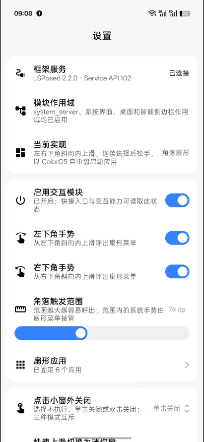

  

<h1 align="center">Flyme 小窗（Free）</h1>

  
  
  
  

把魅族的 Flyme 小窗交互搬到 ColorOS：从屏幕底角斜向内上滑呼出扇形菜单，滑到目标松手，当即以自由浮窗打开。

这是一个 LSPosed 模块，在不改动系统分区的前提下增强 ColorOS 的自由浮窗：扇形菜单、通知与横幅小窗、侧边栏目录、更多面板、内容传送门都走系统自己的窗口与管理链路，设置改完即时生效。

## 预览

  

## 功能

### 扇形菜单

- **呼出**：底角斜向内上滑，可选左右、仅左、仅右
- **保持挂起**：松手后不收起，可继续滑动点选
- **范围与大小**：底角识别区 24–160 dp，图标判定半径 40–220 dp，图标 32–56 dp，拖动时屏幕实时预览
- **背景遮罩**：压暗与模糊合并为一条滑条，向左压暗、向右系统实时模糊（最高 100 dp），居中即不处理背景；模糊由系统合成，背后的画面随手势虚化，不是模块自绘的磨砂
- **暂停**：横屏与游戏模式只暂停呼出，退出后自动恢复

### 扇形应用

最多六项，程序、分身、侧边栏工具与快捷入口可以混排；长按拖动排序，滑到某格放大作反馈，松手即启动。

### 「更多」面板

扇形末尾的「更多」取自智能侧边栏的「全部」，支持收藏、最近与名称搜索；呼出扇形时自动收起。

### 小窗交互

- **关闭小窗**：轻击窗外、双击窗外，或轻点窗口底部横条
- **小窗数量**：并发上限提到 1–5
- **自动收窗**：超出数量时关闭旧窗口，而不是收成贴边浮标
- **贴边挂机**：魅族同款贴边，收成贴边浮标后的应用继续保持前台运行
- **长按静音**：长按浮动窗口只静音该应用，再次长按恢复，其他应用不受影响
- **解除限制**：原本不支持自由浮窗的应用也能打开
- **快速上滑**：底部横条上滑切为迷你形态
- **轻量打开**：按场景决定是否以小窗打开——通知中心、通知横幅、控制中心、应用跳转、复制链接（登录授权与应用分享交给官方处理）
- **禁用浮窗**：列表内的应用，别人拉起它、它拉起别人都不改写

### 贴边挂机

窗口收成贴边浮标后，应用不进入暂停，继续按前台状态运行。系统原本会在这一刻把任务移回后台并通知应用暂停，模块把这一步拦下，浮标照常出现。游戏可以继续渲染、挂机，资源下载与更新也不会中断。

只对浮标里的任务生效；没有浮标时不介入，其他应用照常。浮标里的应用会持续占用 CPU 与 GPU，耗电和发热会上升，不需要时关掉开关即可。

锁屏时窗口按系统原本的方式隐藏、不会自行展开；解锁后从浮标或轮盘都能正常打开。

应用进入浮标期间会同时获得系统后台豁免（省电白名单），锁屏后新建网络请求、换集连播不再被后台限制卡住；离开浮标后自动撤销。

### 长按静音

在小窗、迷你窗上长按约 0.5 秒，只把**当前窗口所属的那个应用**静音，再长按恢复。静音走系统的单应用音量通道，不会把媒体流整体静音，也不会影响同时在用的其他应用。

判定条件：按下的位置要落在当前浮动窗口的可见区域内，且位移不超过 40px；正常拖动、缩放窗口不会误触发。

### 自由传送

解除官方传送门白名单限制，优化使用逻辑。当前适配内容传送门 **17.3.18** 与 **17.5.4**（ColorOS 17）；系统升级后若传送门接口变化，需按新版本重新适配。

优化官方内容传送门：长按即可弹出分享菜单，松手点选。触发快慢可自由调整

### 排除列表

列表内的应用在前台时，模块全部功能停用，离开自动恢复。

### 其他

- **详细日志**：按需开启，用于反馈问题
- **锁屏与息屏**：停止响应，解锁恢复

## 安装

> 3.0 更换了包名与签名：从旧版本升级必须先卸载旧版再安装，旧配置不迁移。

1. 装好并启用 **LSPosed**（需支持 libxposed API 102）
2. 安装本模块，勾选五项作用域：**系统框架**、**系统界面**、**桌面**、**智能侧边栏**、**内容传送门**
3. 重启上述进程或重启设备
4. 打开 **Free**，确认框架已连接，再按需调整

## 兼容性

| 项 | 要求 |
|---|---|
| 系统 | ColorOS 15 / 16 / 17（Android 15 及以上） |
| 自由传送 | 内容传送门 17.3.18 / 17.5.4（ColorOS 17） |
| 框架 | LSPosed，libxposed API 102 及以上 |
| 导航方式 | 手势导航（三键导航下底角区与返回键冲突，模块保持关闭） |

## 已知限制

- 依赖厂商私有的自由浮窗与侧边栏接口，仅适用于 ColorOS 15、16 与 17
- 需要回传结果的跨应用启动（登录、授权、选图、分享回传）与分享流程交给官方处理，模块不改写
- 自由传送取不到自绘界面与独立窗口里的网页

## 致谢

- [Mangi-11/Flyna](https://github.com/Mangi-11/Flyna)：上游来源，原作者 Mangi-11
- [Flyme](https://www.flyme.com/)：交互设计参考
- [libxposed API](https://github.com/libxposed/api)：现代 Xposed API
- [vialoyed-ctrl](https://github.com/vialoyed-ctrl)：内容传送门的分享面板与实现思路
- [Glasmio](https://github.com/NEORUAA/Glasmio)：界面组件库（Liquid Glass），设置页与弹层基于它实现

界面层的第三方许可合规：Glasmio 0.1.3 以 Apache-2.0 发布，使用 Maven Central 的原始 AAR、未修改库源码，完整许可文本随 APK 附带在 `assets/licenses/glasmio-APACHE-2.0.txt`；其折射算法与连续圆角几何适配自 [AndroidLiquidGlass](https://github.com/Kyant0/AndroidLiquidGlass)、[Capsule](https://github.com/Kyant0/Capsule) 与 [Shapes](https://github.com/Kyant0/Shapes)（均为 Apache-2.0）。应用图标的目录扫描使用 [DexKit 2.3.0](https://github.com/LuckyPray/DexKit/tree/2.3.0)（Apache-2.0 / LGPL-3.0）。完整声明见 [THIRD_PARTY_NOTICES.md](THIRD_PARTY_NOTICES.md)。

## 许可

本项目以上游相同的 [GNU General Public License v3.0](LICENSE) 发布，完整协议文本见仓库根目录的 `LICENSE`，APK 内亦随附于 `assets/licenses/GPL-3.0.txt`。

第三方组件各自遵循其自身许可（Glasmio、DexKit 等），声明见 [THIRD_PARTY_NOTICES.md](THIRD_PARTY_NOTICES.md)。
