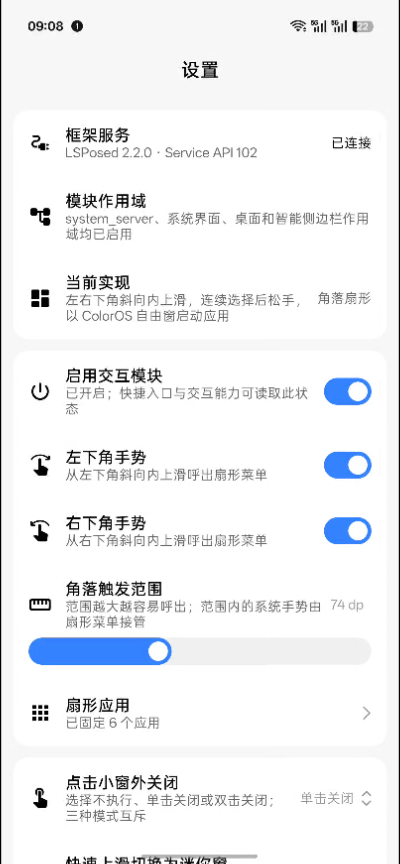

  

<h1 align="center">Flyme 小窗（FlymeFreeform）</h1>

  
  
  
  

把魅族的 Flyme 小窗交互搬到 ColorOS：从屏幕底角斜向内上滑呼出扇形菜单，滑到目标松手，当即以自由浮窗打开。

## 预览

  

## 功能

### 扇形菜单

- **呼出**：底角斜向内上滑，可选左右、仅左、仅右
- **保持挂起**：松手后不收起，可继续滑动点选
- **范围与大小**：底角识别区 24–160 dp，图标判定半径 40–140 dp，图标 32–56 dp，拖动时屏幕实时预览
- **暂停**：横屏与游戏模式只暂停呼出，退出后自动恢复

### 扇形应用

最多六项，程序、分身、侧边栏工具与快捷入口可以混排；长按拖动排序，滑到某格放大作反馈，松手即启动。

### 「更多」面板

扇形末尾的「更多」取自智能侧边栏的「全部」，支持收藏、最近与名称搜索；呼出扇形时自动收起。

### 小窗交互

- **关闭小窗**：轻击窗外、双击窗外，或轻点窗口底部横条
- **小窗数量**：并发上限提到 1–5
- **自动收窗**：超出数量时关闭旧窗口，而不是收成贴边浮标
- **贴边保活**：魅族同款贴边，收成贴边浮标后的应用继续保持前台运行
- **长按静音**：长按浮动窗口只静音该应用，再次长按恢复，其他应用不受影响
- **解除限制**：原本不支持自由浮窗的应用也能打开
- **快速上滑**：底部横条上滑切为迷你形态
- **轻量打开**：按场景决定是否以小窗打开——通知中心、通知横幅、控制中心、打开应用、登录授权、应用分享、系统代发、复制链接
- **禁用浮窗**：列表内的应用，别人拉起它、它拉起别人都不改写

### 贴边保活

窗口收成贴边浮标后，应用不进入暂停，继续按前台状态运行。系统原本会在这一刻把任务移回后台并通知应用暂停，模块把这一步拦下，浮标照常出现。游戏可以继续渲染、挂机，资源下载与更新也不会中断。

只对浮标里的任务生效；没有浮标时不介入，其他应用照常。浮标里的应用会持续占用 CPU 与 GPU，耗电和发热会上升，不需要时关掉开关即可。

锁屏时窗口按系统原本的方式隐藏、不会自行展开；解锁后从浮标或轮盘都能正常打开。

应用进入浮标期间会同时获得系统后台豁免（省电白名单），锁屏后新建网络请求、换集连播不再被后台限制卡住；离开浮标后自动撤销。

### 长按静音

在小窗、迷你窗上长按约 0.5 秒，只把**当前窗口所属的那个应用**静音，再长按恢复。静音走系统的单应用音量通道，不会把媒体流整体静音，也不会影响同时在用的其他应用。

判定条件：按下的位置要落在当前浮动窗口的可见区域内，且位移不超过 40px；正常拖动、缩放窗口不会误触发。

### 自由分享

解除官方传送门白名单限制，优化使用逻辑（仅 ColorOS 17）。

优化官方内容传送门：长按即可弹出分享菜单，松手点选。触发快慢可自由调整

### 排除列表

列表内的应用在前台时，模块全部功能停用，离开自动恢复。

### 其他

- **详细日志**：按需开启，用于反馈问题
- **锁屏与息屏**：停止响应，解锁恢复

## 安装

1. 装好并启用 **LSPosed**（需支持 libxposed API 102）
2. 安装本模块，勾选三项作用域：**系统框架**、**系统界面**、**智能侧边栏**
3. 重启上述进程或重启设备
4. 打开「Flyme 小窗」，确认框架已连接，再按需调整

## 兼容性

| 项 | 要求 |
|---|---|
| 系统 | ColorOS 16 与 17（Android 16 及以上） |
| 自由分享 | 仅 ColorOS 17 |
| 框架 | LSPosed，libxposed API 102 及以上 |
| 导航方式 | 手势导航（三键导航下底角区与返回键冲突，模块保持关闭） |

## 已知限制

- 依赖厂商私有的自由浮窗与侧边栏接口，仅适用于 ColorOS 16 与 17
- 带文件的应用分享、隐式 VIEW 且需要回传结果的启动、游戏内的第三方登录不做改写
- 自由分享取不到自绘界面与独立窗口里的网页

## 致谢

- [Mangi-11/FlymeFreeform](https://github.com/Mangi-11/FlymeFreeform)：上游来源，原作者 Mangi-11
- [Flyme](https://www.flyme.com/)：交互设计参考
- [libxposed API](https://github.com/libxposed/api)：现代 Xposed API
- [vialoyed-ctrl](https://github.com/vialoyed-ctrl)：内容传送门的分享面板与实现思路
